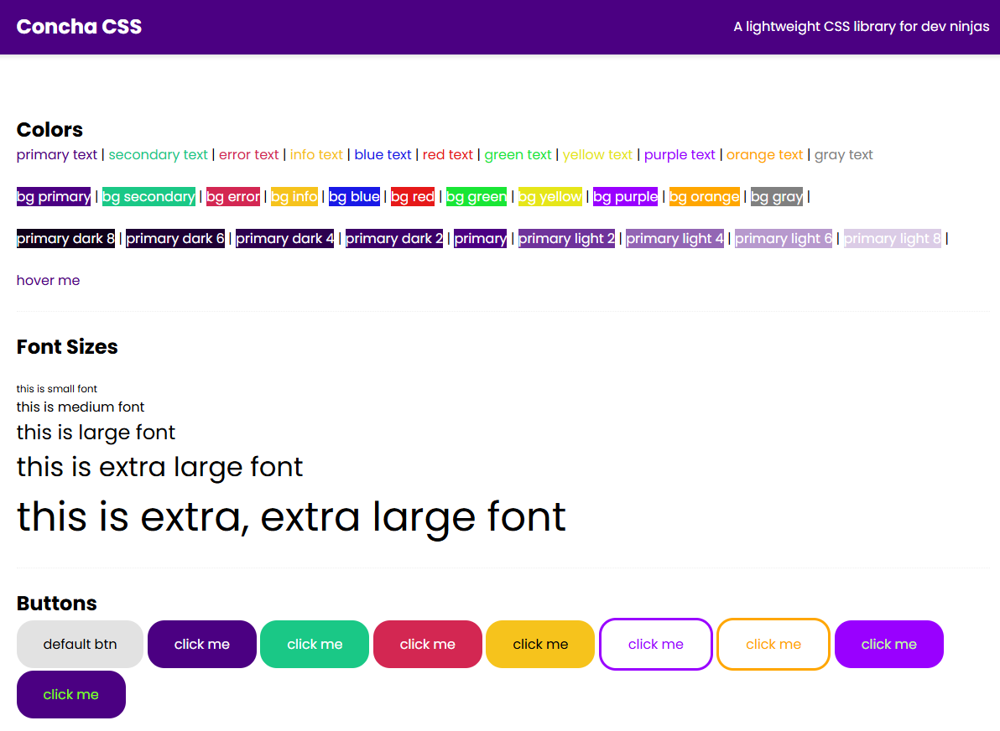

# 📌 SASS Library

Biblioteca de estilos criada em SASS.
Essa biblioteca foi criada em um curso de SAS disponibilizado no YouTube no canal Net Ninja.

<br>

## 🚀 Tecnologias utilizadas

* HTML 5
* CSS 3 / SASS
* Gulp

<br>

## 🎯 Funcionalidades

* [ ] Variáveis
* [ ] Sistema de Grid
* [ ] Breakpoints
* [ ] Componentes

<br>

## 📸 Preview



<br>

## 👤 Como interagir com o projeto

Acesse o [Link](https://dogs-wine.vercel.app/)

<br>

## ⚙️ Como rodar o projeto

```bash
# Clonar o repositório
git clone https://github.com/andressatomiozzo/SASS-library.git

# Entrar na pasta
cd SASS-library

# Instalar dependências
npm install

# Rodar o compilador do SASS
npm run gulp

# Visualizar o index.html
# Extensão: Live Server
```

<br>


## 🧠 Aprendizados

* @import: Importar código de outro documento;
* _file: Partials, arquivos que não precisam ser compilados;
* @debug: verificar o resultado do código;
* #{$variable}: interpolação;
* @mixins / @include: evita repetir código (aceita propriedades);
* @extend: evita repetir código;
* %class-name: usada, geralmente, em conjunto com o extend, como modelo;
* @each / @for: interações;


<br>

# ⭐ Contribuição

Sinta-se livre para contribuir, abrir issues ou sugerir melhorias para o projeto.